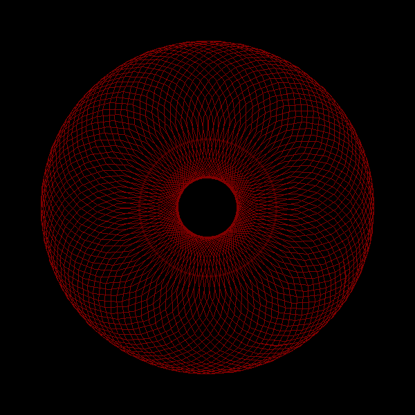

# Hyperbolic Laguerre transformations

Python code for visualising hyperbolic Laguerre transformations, using 2×2 matrices over the split-complex numbers.

These transformations act on oriented lines in the hyperbolic plane. The code represents a line by its two endpoints on the boundary and draws the resulting family of lines in the Poincaré disc.



## Example

From the repository directory, with Python 3 and Tk support available:

```sh
python -m pip install numpy scipy Pillow matplotlib
python -m examples.example_flattening
```

The example interpolates from the identity to the following transformation and displays the resulting animation:

```python
from numpy import linspace, pi
from hyperbolic_laguerre_transformations import (
    animate_transformation,
    double_matrix,
    make_line,
)

my_lines = [make_line(t, t + pi/2) for t in linspace(0, 2*pi, 100)]
transformation = double_matrix(20, 0, 0, 0, 0, 0, 1, 0)

animate_transformation(transformation, my_lines)
```

## Background

The related [Euclidean Laguerre transformations](https://github.com/wlad-svennik/laguerre_transformations) use dual numbers and act on oriented lines in the Euclidean plane. This project uses split-complex numbers, also called double numbers, for the hyperbolic case.

See [Laguerre transformations on Wikipedia](https://en.wikipedia.org/wiki/Laguerre_transformations) for background.

The code is available under the [BSD 3-Clause licence](LICENSE.txt).

